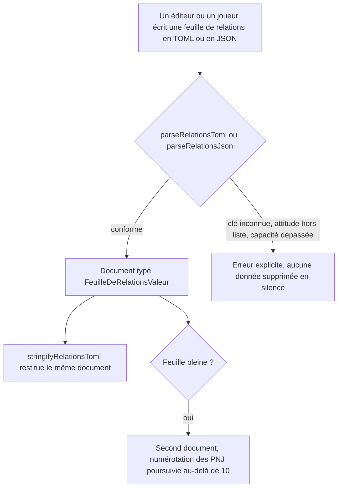
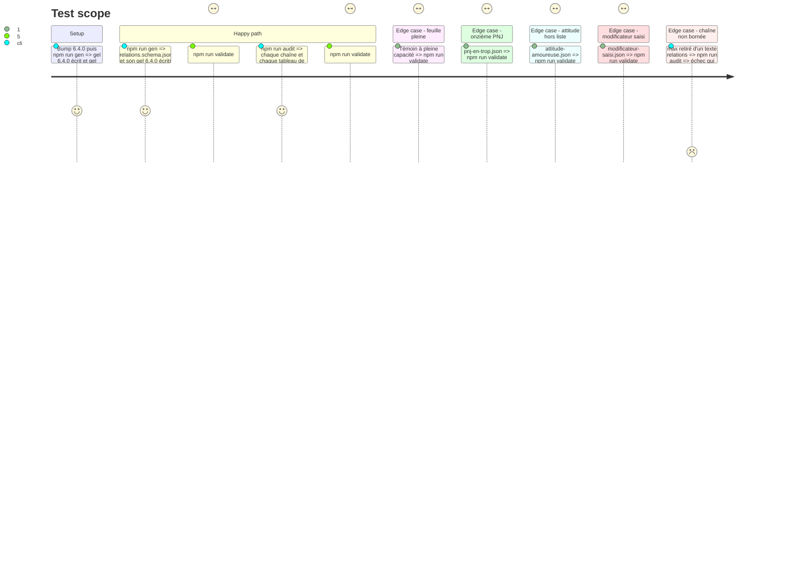

# Instruction: Contrat de données `relations` et base 6.4.0

## Architecture projection

> Tree of the final files. ✅ create · ✏️ modify · ❌ delete

```txt
.
├── package.json                                   ✏️ version, exports["./schemas/*"], files → 6.4.0
├── package-lock.json                              ✏️ version 6.4.0
├── src/
│   ├── contract-version.ts                        ✏️ ADRENALINE_SCHEMA_VERSION = "6.4.0"
│   ├── codecs/documents.ts                        ✏️ cible relations : schéma, type, codec, parse/stringify
│   ├── index.ts                                   ✏️ export FeuilleDeRelations, types, codecs relations
│   └── zod/
│       ├── constants.ts                           ✏️ TARGETS += relations
│       └── adrenaline/relations.ts                ✅ FeuilleDeRelations
├── schemas/adrenaline/
│   ├── relations.schema.json                      ✅ généré, $id sur main
│   └── 6.4.0/                                     ✅ gel généré : pj, pnj, monstre, relations
├── corpus/
│   ├── cases.json                                 ✏️ cas relations indexés
│   ├── temoins/relations/
│   │   ├── temoin.json                            ✅ personnage seul (nom imposé par validate-contract)
│   │   └── pleine-capacite.json                   ✅ 4 PJ, 10 PNJ, textes au plafond
│   └── refus/relations/
│       ├── personnage-absent.json                 ✅
│       ├── attitude-amoureuse.json                ✅
│       ├── type-de-lien-inconnu.json              ✅
│       ├── autre-pj-en-trop.json                  ✅
│       ├── pnj-en-trop.json                       ✅
│       ├── texte-au-dela-de-la-capacite.json      ✅
│       ├── numero-hors-borne.json                 ✅
│       ├── tests-de-drame-negatif.json            ✅
│       ├── modificateur-saisi.json                ✅
│       ├── cle-inconnue.json                      ✅
│       └── presentation-adapter-inconnu.json      ✅
├── examples/adrenaline/relations/
│   └── feuille-de-relations.toml                  ✅ contenu inventé, aucun matériel publié
└── tools/
    ├── audit-schemas.ts                           ✏️ relations : chaque chaîne et chaque tableau bornés
    ├── validate-contract.ts                       ✏️ contrôles etatDePartie limités aux cibles qui le publient
    └── validate-package.ts                        ✏️ clés des codecs + lecture de l'exemple relations
```

## User Journey



## Test Scope



## Tasks to do

### `1)` Ouvrir la base 6.4.0

> Changer de version avant toute génération, pour que le gel 6.3.0 déjà publié ne soit jamais réécrit.

1. `package.json` : `version` passe à `6.4.0`, `exports["./schemas/*"]` à `./schemas/adrenaline/6.4.0/*`, `files` à `schemas/adrenaline/6.4.0`.
2. `src/contract-version.ts` : `ADRENALINE_SCHEMA_VERSION = "6.4.0"`. `ADRENALINE_CONTRACT_VERSION` (6) et `ADRENALINE_TOML_VERSION` (1.0.0) ne bougent pas.
3. Remettre le lock en accord : `npm.cmd install --package-lock-only`.
4. `tools/validate-package.ts` interpole déjà la version : ne rien y toucher pour le bump.

### `2)` Écrire le contrat `FeuilleDeRelations`

> Créer `src/zod/adrenaline/relations.ts` : une feuille A4 dont la contenance est bornée dans le contrat.

1. Exporter les capacités nommées, avec la raison en commentaire : `AUTRES_PJ_EMPLACEMENTS = 4`, `PNJ_EMPLACEMENTS = 10`, `NUMERO_PNJ_MAXIMUM = 99`, `NOM_CAPACITE = 60`, `CE_QUE_JE_SAIS_CAPACITE = 160`, `DETTE_CAPACITE = 100`, `LIEN_DESCRIPTION_CAPACITE = 60`, `CE_QUI_LUI_EST_ARRIVE_CAPACITE = 120`, `NOTES_PNJ_CAPACITE = 120`.
2. Exporter `AttitudeDePnj = z.enum(["hostile", "inamicale", "indifferente", "amicale", "loyale"])`, dans cet ordre, de la plus hostile à la plus loyale. Exporter aussi `TypeDeLien = z.enum(["familial", "amitie", "travail"])`.
3. Ligne d'en-tête, à la racine : `personnage` (requis, `min(1).max(NOM_CAPACITE)`), puis `joueur` et `partie` (optionnels, mêmes bornes). Les descriptions précisent que `partie` est le nom de la partie ou de la campagne.
4. `autresPersonnages` : tableau `.max(AUTRES_PJ_EMPLACEMENTS)`, optionnel. Chaque élément est un `strictObject` qui porte `nom` (requis), `ceQueJeSais`, `ceQueJeLuiDois` et `ceQuIlMeDoit` (textes optionnels et bornés). Aucun champ de modificateur.
5. `testsDeDrame` : `Compte.optional()`. La description dit que c'est un décompte des tests faits, qu'on ne déduit jamais des PNJ morts.
6. `pnjs` : tableau `.max(PNJ_EMPLACEMENTS)`, optionnel. Chaque élément est un `strictObject` qui porte :
   - `numero` : requis, `z.int().min(1).max(NUMERO_PNJ_MAXIMUM)` ;
   - `nom` : requis ;
   - `attitude` : `AttitudeDePnj`, optionnel ;
   - `lien` : `strictObject`, optionnel, qui porte `type` (`TypeDeLien`, requis) et `description` (optionnelle, bornée) ;
   - `reliesA` : tableau de numéros bornés comme `numero`, `.max(PNJ_EMPLACEMENTS - 1)`, optionnel ;
   - `ceQuiLuiEstArrive` et `notes` : textes optionnels et bornés.
7. Écrire les descriptions des PNJ :
   - `attitude` : c'est l'attitude du PNJ envers le PJ propriétaire de la feuille, et elle seule fixe le modificateur aux tests d'Arme sociale ;
   - `notes` : on y range l'attitude du PJ envers le PNJ, l'autorité sociale et les nuances ;
   - `numero` : un éditeur doit garder le numéro unique et stable, et le schéma ne le vérifie pas.
8. `meta: Meta.optional()`. À la racine : `.meta({ $id: ".../main/schemas/adrenaline/relations.schema.json", title: "Feuille de relations — Adrenaline System", description })`. La présentation arrive en phase 2.
9. Exporter le type `FeuilleDeRelationsValeur`. Ni `.default()`, ni `.refine()`, ni `z.object()`.

### `3)` Déclarer la cible et ses codecs

> Rendre `relations` générable, validable et consommable comme les trois cibles existantes.

1. `src/zod/constants.ts` : ajouter `{ game: GAMES.adrenaline, name: "relations", zod: FeuilleDeRelations }` à `TARGETS`.
2. `src/codecs/documents.ts` : ajouter `relations` à `ADRENALINE_DOCUMENT_SCHEMAS`, à `AdrenalineDocumentByTarget` et à `ADRENALINE_DOCUMENT_CODECS`. Ajouter `parseRelationsJson`, `parseRelationsToml`, `stringifyRelationsJson` et `stringifyRelationsToml`.
3. `src/index.ts` : ré-exporter le schéma, les deux enums, le type et les quatre fonctions.
4. Lancer `npm.cmd run gen`. Vérifier que `schemas/adrenaline/relations.schema.json` et `schemas/adrenaline/6.4.0/relations.schema.json` existent, et que `git status` ne montre aucun fichier modifié sous `schemas/adrenaline/6.3.0/`.

### `4)` Corpus et exemple

> Prouver le contrat par des témoins acceptés et un refus par défaut. Aucun contenu n'est recopié d'un livre publié.

1. `corpus/temoins/relations/temoin.json` : `personnage` seul. Le nom `temoin.json` est imposé : `validate-contract.ts` lit ce fichier pour chaque cible.
2. `corpus/temoins/relations/pleine-capacite.json` : en-tête complet, 4 autres PJ et 10 PNJ, chaque texte à sa capacité exacte, numéros 1 et 99, un `reliesA` de 9 numéros.
3. Un fichier par défaut sous `corpus/refus/relations/`, chacun valide en dehors de son défaut :
   - `personnage-absent`
   - `attitude-amoureuse` : l'attitude du folio 86, hors de la liste fermée
   - `type-de-lien-inconnu`
   - `autre-pj-en-trop` : 5 autres PJ
   - `pnj-en-trop` : 11 PNJ
   - `texte-au-dela-de-la-capacite` : capacité + 1
   - `numero-hors-borne` : 0
   - `tests-de-drame-negatif`
   - `modificateur-saisi` : une clé `modificateur` sur un PNJ
   - `cle-inconnue`
   - `presentation-adapter-inconnu` : `{ personnage, presentation: { adapter: "adrenaline-relations" } }`, valide une fois `presentation` retiré
4. `examples/adrenaline/relations/feuille-de-relations.toml` est à plat. Les scalaires racine viennent d'abord, puis les `[[autresPersonnages]]`, puis les `[[pnjs]]` avec `lien` en table inline et `reliesA`, et `[meta]` en dernier.
5. `corpus/cases.json` : indexer chaque fichier (`target: "relations"`, `format`, `expect`).

### `5)` Garde-fous d'outillage

> Faire échouer la chaîne quand une capacité est oubliée ou que la cible manque au paquet.

1. `tools/audit-schemas.ts` : ajouter un bloc propre à `relations`, sur le modèle du bloc PJ des notes. Il parcourt récursivement le JSON Schema généré et exige `maxLength` sur toute `string` et `maxItems` sur tout `array`. En cas d'échec, il nomme le chemin.
2. `tools/validate-contract.ts`, boucle « state-of-play » (lignes 205-230) : n'y faire passer que les cibles dont le schéma généré publie une propriété racine `etatDePartie`. L'information se lit dans le schéma, pas dans une liste en dur. Sur `relations`, les trois refus seraient creux : ils échoueraient de toute façon, sur la clé inconnue. Le script affiche la cible exclue et la raison. Il échoue si aucune cible ne publie `etatDePartie`, pour que ce filtre ne vide pas le contrôle en silence.
3. `tools/validate-package.ts` :
   - les clés de codecs attendues deviennent `["monstre", "pj", "pnj", "relations"]` ;
   - importer `parseRelationsToml`, lire l'exemple empaqueté et vérifier qu'il rend `personnage`.
4. Lancer `npm.cmd run check` depuis l'outil PowerShell, parce que `validate:release` appelle `tar`. Rejouer à la main la mutation de l'audit : retirer un `.max()`, constater l'échec, puis restaurer.

## Test acceptance criteria

| Task | Acceptance criteria |
| ---- | ------------------- |
| 1 | `package.json`, le lock et `ADRENALINE_SCHEMA_VERSION` annoncent tous 6.4.0. Le contrat reste 6 et le TOML reste 1.0.0. |
| 2 | Le JSON Schema généré n'a que `personnage` dans le `required` racine. Il expose les deux enums dans l'ordre prévu et une description sur chaque propriété. Aucune propriété ne parle de modificateur. |
| 3 | `ADRENALINE_DOCUMENT_CODECS.relations` lit et réécrit l'exemple TOML sans perte. Le gel 6.4.0 contient les quatre cibles, et aucun fichier de `schemas/adrenaline/6.3.0/` n'a changé. |
| 4 | `validate:contract` accepte les deux témoins et l'exemple TOML, et rejette chacun des onze refus. |
| 5 | `validate:contract` montre que les contrôles `etatDePartie` tournent encore pour pj, pnj et monstre, et qu'ils sont exclus avec leur raison pour relations. L'audit échoue en nommant la propriété dès qu'un texte ou un tableau de `relations` perd sa borne. `validate:package` voit la clé `relations` dans le tarball installé. `npm run check` sort 0. |
