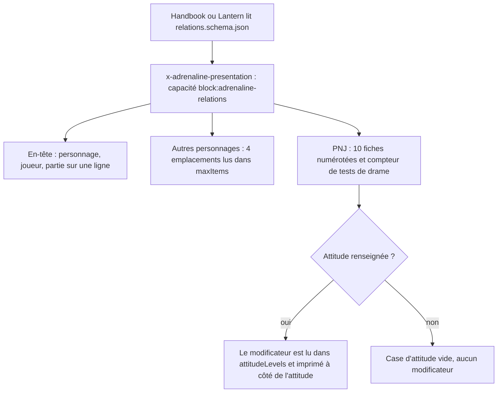
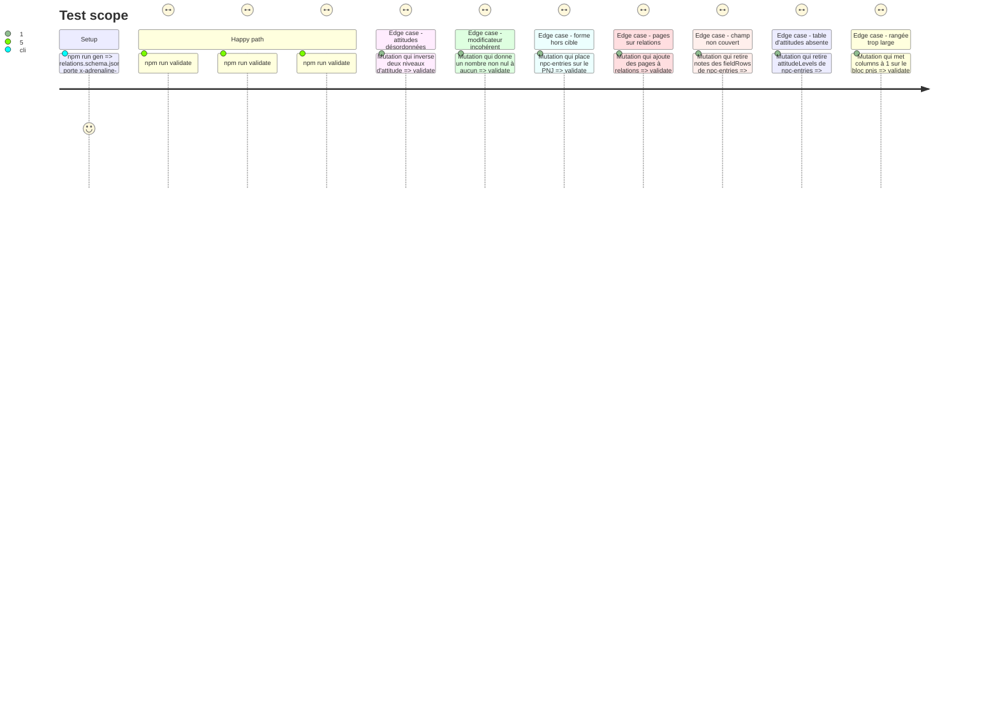

# Instruction: Présentation papier de la feuille

## Architecture projection

> Tree of the final files. ✅ create · ✏️ modify · ❌ delete

```txt
.
├── src/
│   ├── presentation.ts                    ✏️ cible relations dans les types, 3 formes, AdrenalineAttitudeLevel,
│   │                                         attitudeLevels, ATTITUDE_LEVELS, RELATIONS_PRESENTATION
│   ├── index.ts                           ✏️ export RELATIONS_PRESENTATION, ATTITUDE_LEVELS, type AdrenalineAttitudeLevel
│   └── zod/adrenaline/relations.ts        ✏️ x-adrenaline-presentation: RELATIONS_PRESENTATION
├── schemas/adrenaline/
│   ├── relations.schema.json              ✏️ régénéré avec l'annotation
│   └── 6.4.0/relations.schema.json        ✏️ régénéré avec l'annotation (gel pas encore publié)
└── tools/
    ├── validate-presentation.ts           ✏️ cible relations, formes, attitudeLevels, auto-tests
    └── validate-package.ts                ✏️ annotation relations = RELATIONS_PRESENTATION exportée
```

## User Journey



## Test Scope



## Wireframe

```txt
┌──────────────────────────────────────────────────────────────┐
│ (1) Personnage ____________ Joueur _________ Partie ________ │
├──────────────────────────────────────────────────────────────┤
│ (2) Autres personnages                                       │
│ ┌─────────────┬─────────────┬─────────────┬─────────────┐    │
│ │(3) Nom ____ │ Nom ____    │ Nom ____    │ Nom ____    │    │
│ │ Ce que je   │             │             │             │    │
│ │ sais ______ │             │             │             │    │
│ │ Je lui dois │             │             │             │    │
│ │ Il me doit  │             │             │             │    │
│ └─────────────┴─────────────┴─────────────┴─────────────┘    │
├──────────────────────────────────────────────────────────────┤
│ (4) PNJ                            (5) Tests de drame ____   │
│ (6) Attitudes et modificateur, de hostile à loyale           │
│ ┌───────────────────────────┬───────────────────────────┐    │
│ │(7) n° __ Nom ____________ │ n° __  Nom ____________   │    │
│ │ Attitude ______ (modif.)  │ Attitude ______ (modif.)  │    │
│ │ Lien □fam □ami □trav __   │ Lien □fam □ami □trav __   │    │
│ │ Relié à __ __ __ __ __    │ Relié à __ __ __ __ __    │    │
│ │ Ce qui lui est arrivé _   │ Ce qui lui est arrivé _   │    │
│ │ Notes _________________   │ Notes _________________   │    │
│ ├───────────────────────────┼───────────────────────────┤    │
│ │ n° __ … (5 rangées)       │ n° __ …                   │    │
│ └───────────────────────────┴───────────────────────────┘    │
└──────────────────────────────────────────────────────────────┘
```

1. En-tête : nom du personnage, du joueur et de la partie, sur une seule ligne, comme l'a demandé l'utilisateur.
2. Section des autres PJ : leur nombre d'emplacements est le `maxItems` du schéma (4).
3. Emplacement d'un autre PJ : son nom et trois textes libres, sans aucun modificateur.
4. Section des PNJ, qui occupe le reste de la page A4.
5. Compteur de tests de drame : un seul pour toute la feuille.
6. Légende des cinq attitudes et de leur modificateur, imprimée d'après `attitudeLevels`.
7. Fiche d'un PNJ : numéro stable, nom, attitude suivie du modificateur qu'on en déduit, type et description du lien, numéros reliés, ce qui lui est arrivé, notes. Deux colonnes de cinq rangées, soit 10 PNJ (`maxItems`).

## Tasks to do

### `1)` Étendre le vocabulaire de présentation

> Rendre la cible `relations` et ses formes exprimables dans les types publiés.

1. `AdrenalinePresentation` : ajouter `"relations"` aux unions de `capability` et de `sheet.id`.
2. `AdrenalinePresentationForm` : ajouter `"pc-ties"` (emplacements des autres PJ), `"npc-entries"` (fiches de PNJ numérotées) et `"counter"` (valeur entière écrite après un libellé).
3. Créer le type `AdrenalineAttitudeLevel = { key: "hostile" | "inamicale" | "indifferente" | "amicale" | "loyale"; label: string; nature: "bonus" | "malus" | "aucun"; count: number }`.
   - Son commentaire dit que la correspondance avec l'enum du contrat est positionnelle et vérifiée par le validateur.
   - `presentation.ts` n'importe jamais `relations.ts`, qui l'importe déjà : ce serait un import circulaire.
4. `AdrenalinePresentationBlock` : ajouter `attitudeLevels?: readonly AdrenalineAttitudeLevel[]`, commenté « `npc-entries` only ».
5. Mettre à jour le commentaire de `fieldRows` : sur un bloc qui lit un tableau, il nomme les propriétés de chaque élément.

### `2)` Publier la table des attitudes

> Déduire le modificateur de l'attitude au lieu de le saisir.

1. Créer la constante `ATTITUDE_LEVELS`, cinq entrées dans l'ordre de l'enum, `as const satisfies readonly AdrenalineAttitudeLevel[]`.
2. Relire nature et nombre aux folios 48 et 61 du livre de base, au moment de coder. Le commentaire cite le folio et rappelle qu'un bonus ou un malus vaut 10 %. Les valeurs vivent dans le code, jamais dans `aidd_docs/`.
3. Libellés avec accents : « Hostile », « Inamicale », « Indifférente », « Amicale », « Loyale ».

### `3)` Déclarer `RELATIONS_PRESENTATION`

> Décrire la feuille A4 du wireframe sous forme de sections, de blocs et de chemins.

1. `definePresentation({ version: 1, capability: "block:adrenaline-relations", sheet: { id: "adrenaline-relations", label: "Feuille de relations" }, appearance: PAPER_SHEET, values: VALUES, … })`.
2. Chaque bloc porte les clés que le validateur exige (`id`, `label`, `order`, `layout`, `paths`), plus un `columns` qui laisse tenir ses rangées les plus larges.
3. Section `entete` (`banner`, ordre 1) avec un bloc `entete` :
   - `label: "En-tête"`, `order: 1`, `layout: "columns"`, `columns: 3` ;
   - `form: "name-card"`, `paths: ["/personnage", "/joueur", "/partie"]` ;
   - une seule rangée `pointerRows` de trois cellules libellées Personnage, Joueur et Partie : elle demande `columns ≥ 3`.
4. Section `autresPersonnages` (`grid`, 4 colonnes, ordre 2) avec un bloc `autresPersonnages` :
   - `label: "Autres personnages"`, `order: 1`, `layout: "stack"`, `columns: 1` ;
   - `form: "pc-ties"`, `paths: ["/autresPersonnages"]` ;
   - `fieldRows: [["nom"], ["ceQueJeSais"], ["ceQueJeLuiDois"], ["ceQuIlMeDoit"]]` décrit un emplacement. Les 4 colonnes de la section en juxtaposent 4.
5. Section `pnjs` (`grid`, 2 colonnes, ordre 3) avec deux blocs :
   - `testsDeDrame` : `label: "Tests de drame"`, `order: 1`, `layout: "stack"`, `form: "counter"`, `paths: ["/testsDeDrame"]` ;
   - `pnjs` : `label: "PNJ"`, `order: 2`, `layout: "stack"`, `columns: 2`, `form: "npc-entries"`, `paths: ["/pnjs"]`, `attitudeLevels: ATTITUDE_LEVELS`. Ses `fieldRows` valent `[["numero", "nom"], ["attitude"], ["lien"], ["reliesA"], ["ceQuiLuiEstArrive"], ["notes"]]`, et la première rangée demande `columns ≥ 2`.
6. Pas de `pages`, puisque la feuille tient sur une seule page. Pas de `minimumRows` non plus : le nombre d'emplacements imprimés est le `maxItems` du schéma (`editorBounds: "json-schema"`). `hiddenPaths: ["/meta"]`.
7. Ajouter `"x-adrenaline-presentation": RELATIONS_PRESENTATION` au `.meta()` racine de `FeuilleDeRelations`, puis lancer `npm.cmd run gen`.
8. `src/index.ts` : exporter `RELATIONS_PRESENTATION`, `ATTITUDE_LEVELS` et le type `AdrenalineAttitudeLevel`.

### `4)` Étendre le validateur de présentation

> Faire respecter le contrat de la nouvelle feuille, et refuser ses formes ailleurs.

1. `tools/validate-presentation.ts` :
   - `Target` et `TARGETS` reçoivent `"relations"` ;
   - `FORMS` reçoit les trois formes ;
   - la boucle de lecture couvre `schemas/adrenaline/relations.schema.json`.
2. Ajouter une table des blocs attendus pour `relations`, sur le modèle de celle du PJ : identifiant → forme et chemins.
3. Adapter les règles génériques existantes :
   - Liste blanche des clés de bloc (`keys()`, vers la ligne 767) : y ajouter `attitudeLevels` quand il est présent.
   - Règle `fieldRows` (vers la ligne 847), qui n'accepte aujourd'hui que `identity-fields` : l'ouvrir à `pc-ties` et à `npc-entries`.
   - Toujours dans cette règle : quand le chemin désigne un tableau (`type: "array"`), lire les propriétés dans `items.properties` au lieu de `properties`. Le contrôle « chaque champ nommé une fois » et le contrôle de largeur `columns` restent les mêmes.
   - Le filtre `PJ_IDENTITY_SIBLINGS` reste réservé à `pj`.
4. Ajouter les règles propres à `relations` :
   - les trois formes nouvelles sont refusées hors de `relations` ;
   - `attitudeLevels` est obligatoire sur `npc-entries` et interdit partout ailleurs ;
   - les clés de `attitudeLevels` suivent, dans l'ordre, l'enum `attitude` lu dans le schéma généré ;
   - chaque libellé est non vide, `count` est un entier, et `nature: "aucun"` va si et seulement si `count` vaut 0 ;
   - les `fieldRows` de `pc-ties` et de `npc-entries` couvrent une seule fois chaque propriété des éléments, telles que le schéma les déclare.
5. Les règles réservées au PJ restent refusées sur `relations` : `pages`, `notes`, `minimumRows`, `thresholdLevels`.
6. Ajouter des auto-tests, une mutation par règle :
   - niveaux inversés ;
   - nombre non nul pour `aucun` ;
   - `npc-entries` sur le PNJ ;
   - `pages` ajoutées à `relations` ;
   - `notes` retiré des `fieldRows` ;
   - `attitudeLevels` absent ;
   - `columns: 1` sur le bloc `pnjs`, dont la rangée `["numero", "nom"]` déborde alors.
   Les auto-tests existants sur `fieldRows` des `identity-fields` doivent continuer à passer : l'assouplissement ne relâche rien pour eux.
7. `tools/validate-package.ts` : dans le script consommateur, vérifier que `x-adrenaline-presentation` du schéma `relations` installé est égal à `RELATIONS_PRESENTATION`, et que la capacité vaut `block:adrenaline-relations`.
8. Lancer `npm.cmd run check` depuis l'outil PowerShell.

## Test acceptance criteria

| Task | Acceptance criteria |
| ---- | ------------------- |
| 1 | `tsc` accepte `block:adrenaline-relations` et les trois formes. Il refuse une clé d'attitude hors des cinq. |
| 2 | `ATTITUDE_LEVELS` publie cinq niveaux, de hostile à loyale, chacun avec sa nature et son nombre. Aucun fichier de `aidd_docs/` ne contient ces nombres. |
| 3 | Le schéma généré porte une présentation dont l'en-tête affiche personnage, joueur et partie sur une seule rangée. La section PNJ affiche le compteur et les fiches, avec la table des attitudes. |
| 4 | `validate:presentation` accepte la présentation réelle et rejette chacune des sept mutations avec un message qui nomme la règle. Les auto-tests existants sur `identity-fields` passent toujours. `validate:package` constate que l'annotation installée égale l'export. `npm run check` sort 0. |
