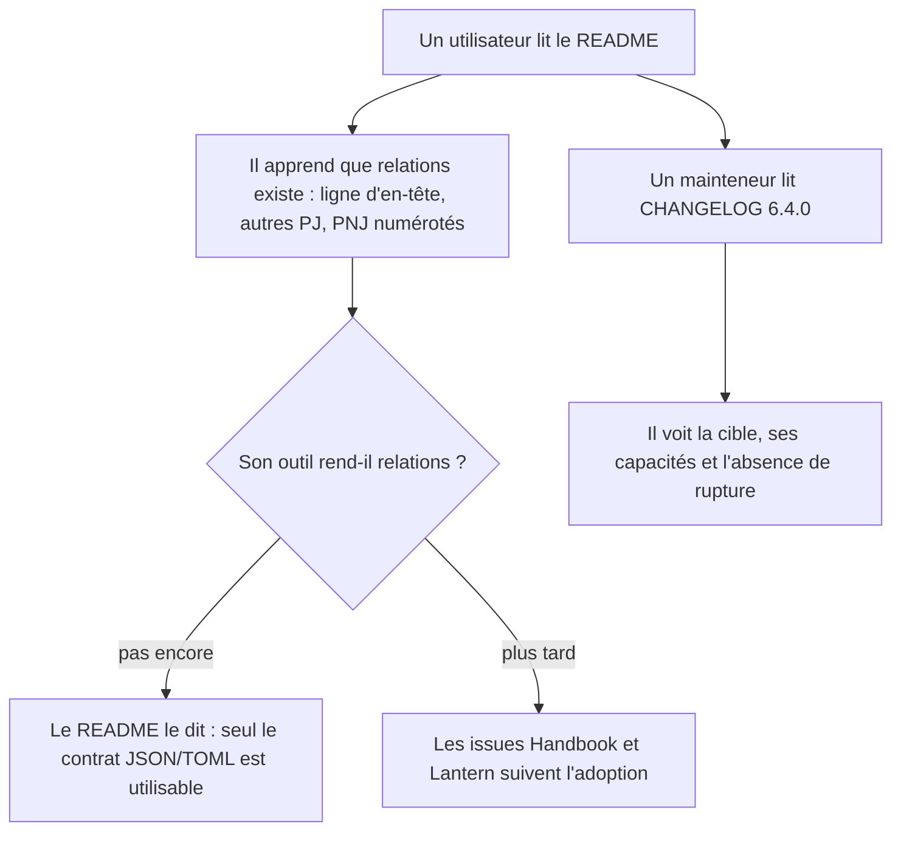
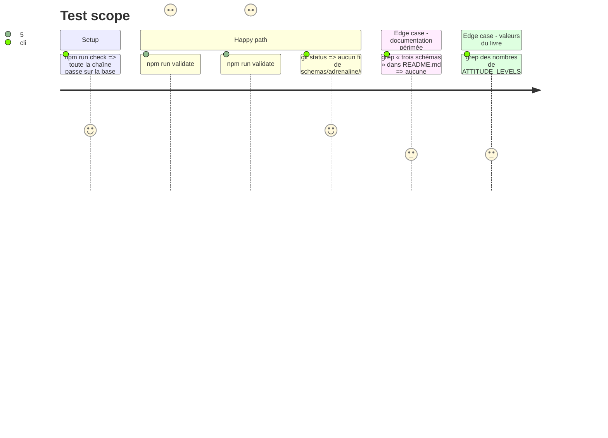

# Instruction: Documentation et suivi des consommateurs

## Architecture projection

> Tree of the final files. ✅ create · ✏️ modify · ❌ delete

```txt
.
├── README.md                              ✏️ quatre schémas, ligne relations dans la table, clés du registre de codecs,
│                                             Handbook et Lantern ne rendent pas encore relations
├── CHANGELOG.md                           ✏️ section Added sous [Unreleased]
├── CLAUDE.md                              ✏️ (non suivi) entrée « 4 emplacements » corrigée, checklist d'ajout de cible
└── aidd_docs/tasks/2026_11/2026_11_20_feuille-relations/
    └── suivi-consommateurs.md             ✅ brouillons d'issues obsidian-handbook et lantern, non publiées
```

## User Journey



## Test Scope



## Tasks to do

### `1)` Mettre le README à jour

> Annoncer la quatrième cible sans promettre un rendu qui n'existe pas encore.

1. Remplacer « trois schémas de personnage (`pj`, `pnj`, `monstre`) » par une formulation qui inclut la feuille de relations.
2. Ajouter une ligne `relations` dans la table des schémas : chemin, `$id`, description en une phrase.
3. Ajouter `relations` aux clés de `ADRENALINE_DOCUMENT_CODECS` et aux codecs exportés, partout où le README les liste.
4. Indiquer en une phrase que Handbook et Lantern ne rendent pas encore `relations` : en attendant, le document s'échange en JSON ou en TOML et se valide.
5. Ligne 7 : « déclare `schema-adrenaline@6.3.0` et la baseline de schéma `6.3.0` » passe à 6.4.0.
6. Ne recopier aucune valeur d'attitude : renvoyer vers `ATTITUDE_LEVELS`.

### `2)` Écrire l'entrée de CHANGELOG

> Documenter une version mineure additive.

1. Sous `## [Unreleased]`, ajouter une section `### Added`, en anglais comme les entrées précédentes. Le train de release la renommera en `[6.4.0]` et la datera, comme pour les versions précédentes. Elle décrit :
   - la cible `relations`, ses champs et ses capacités A4 (4 autres PJ, 10 PNJ, numéros de 1 à 99, textes bornés) ;
   - la ligne d'en-tête personnage, joueur et partie ;
   - le modificateur social déduit de l'attitude, jamais saisi ;
   - les trois formes de présentation, `attitudeLevels` et la capacité `block:adrenaline-relations` ;
   - les nouveaux exports.
2. Préciser que le contrat 6 et le TOML 1.0.0 ne changent pas, que les numéros de PNJ ne sont pas vérifiés comme uniques par le schéma, et que la capacité n'est pas exigée par le pack Handbook.

### `3)` Mettre à jour la mémoire projet

> Éviter que le prochain ajout de cible redécouvre les mêmes points d'accroche.

1. `CLAUDE.md` : l'entrée « Bumper `ADRENALINE_SCHEMA_VERSION` touche 4 emplacements » cite encore `1.1.0` et trois littéraux de `validate-package.ts`. La réécrire d'après l'état réel constaté pendant la phase 1.
2. Ajouter une entrée « Ajouter une cible » qui liste les points en dur trouvés pendant les phases 1 et 2 :
   - les clés de codecs dans `tools/validate-package.ts` ;
   - `Target` et `TARGETS` dans `tools/validate-presentation.ts` ;
   - les unions `capability` et `sheet.id` de `src/presentation.ts` ;
   - le nom imposé `corpus/temoins/<cible>/temoin.json`, que lit `tools/validate-contract.ts` ;
   - la règle `fieldRows` de `tools/validate-presentation.ts`, limitée aux formes qu'elle nomme.
   L'audit, lui, tire ses cibles de `TARGETS` : il n'a rien à modifier.
3. Ce fichier n'est pas suivi par git (`.git/info/exclude`) : il n'apparaît dans aucun commit.

### `4)` Préparer le suivi des consommateurs

> Faire adopter la cible par Handbook et Lantern, sans rien publier d'office.

1. Créer `suivi-consommateurs.md` avec deux brouillons d'issue :
   - un pour `RebelliousSmile/obsidian-handbook` : rendre `block:adrenaline-relations`, les formes `pc-ties`, `npc-entries` et `counter`, et imprimer le modificateur d'après `attitudeLevels` ;
   - un pour `RebelliousSmile/lantern` : éditer la feuille, attribuer le prochain numéro libre, proposer les numéros existants dans `reliesA`.
2. Chaque brouillon cite la version 6.4.0, le chemin du schéma et les capacités. Il signale aussi que les capacités sont estimées sans mesure de rendu : le premier rendu réel peut demander de les ajuster.
3. Ne publier aucune issue sans demande explicite de l'utilisateur.

### `5)` Vérification finale

> Prouver que la version 6.4.0 est cohérente de bout en bout.

1. Depuis l'outil PowerShell, lancer `npm run check`, puis `npm run validate:package` et `npm run validate:release`.
2. `git status` : aucun fichier sous `schemas/adrenaline/6.3.0/` n'est modifié. En cas de `M`, trancher avec `git hash-object --path`, comme le décrit `CLAUDE.md`.
3. Vérifier qu'aucun fichier de `aidd_docs/` ne contient la table des attitudes.

## Test acceptance criteria

| Task | Acceptance criteria |
| ---- | ------------------- |
| 1 | Le README annonce 6.4.0, présente quatre schémas, liste `relations` dans la table et dans les codecs, et dit que Handbook et Lantern ne la rendent pas encore. |
| 2 | `CHANGELOG.md` porte, sous `[Unreleased]`, une section Added qui décrit la cible, ses capacités, l'absence de rupture et les limites de vérification. |
| 3 | `CLAUDE.md` ne cite plus `1.1.0` comme version courante et contient la checklist d'ajout de cible. |
| 4 | `suivi-consommateurs.md` contient deux brouillons complets. Aucune issue n'est créée sur GitHub. |
| 5 | `npm run check`, `validate:package` et `validate:release` sortent 0. Aucun fichier du gel 6.3.0 n'est modifié. |
